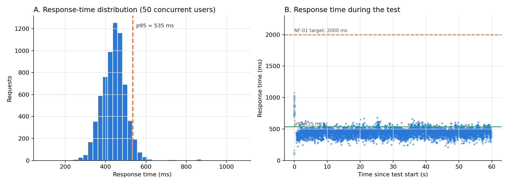

# Performance test (NF-01)

Generated by `python -m tests.perf.load_test` — do not edit by hand.

- Target: http://localhost:8088  ·  run 2026-11-20 11:31
- Load: **50 concurrent users**, for 60 s, each user sending its next query as soon as the answer arrives, no think time (6811 requests; all users start together, no ramp-up)
- HTTP status codes: {'200': 6811}; error rate 0.00 %
- Queries drawn at random from `data/test_queries.csv` (English and Arabic, incl. out-of-scope)
- Answer methods: {'tfidf': 153, 'sbert': 5791, 'fallback': 867}

| Metric | Value |
|---|---|
| Successful requests | 6811 / 6811 (errors: 0) |
| Mean | 442 ms |
| Median (p50) | 443 ms |
| p90 | 511 ms |
| **p95** | **535 ms** |
| p99 | 602 ms |
| Min / max | 92 / 1072 ms |
| Throughput | 112.8 requests/s over 60.4 s |

**NF-01 (p95 < 2000 ms with 50 concurrent users): PASS**

Note: the per-IP chat rate limit was raised for this run because all simulated users share one IP address.

