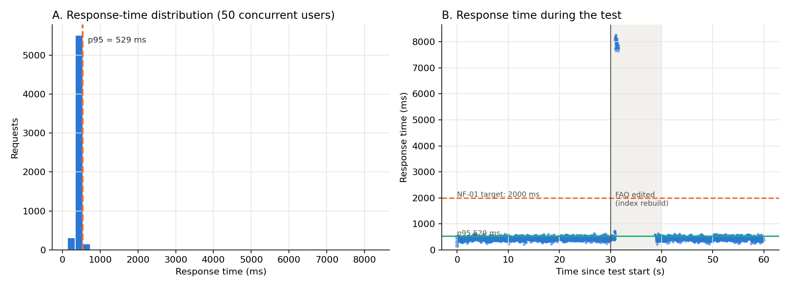

# Performance test (NF-01) — LT-3, during an FAQ index rebuild

Generated by `python -m tests.perf.load_test` — do not edit by hand.

- Target: http://localhost:8088  ·  run 2026-11-20 11:33
- Load: **50 concurrent users**, for 60 s, each user sending its next query as soon as the answer arrives, no think time (6031 requests; all users start together, no ramp-up)
- HTTP status codes: {'200': 6031}; error rate 0.00 %
- Queries drawn at random from `data/test_queries.csv` (English and Arabic, incl. out-of-scope)
- Answer methods: {'tfidf': 131, 'sbert': 5148, 'fallback': 752}

| Metric | Value |
|---|---|
| Successful requests | 6031 / 6031 (errors: 0) |
| Mean | 499 ms |
| Median (p50) | 442 ms |
| p90 | 505 ms |
| **p95** | **529 ms** |
| p99 | 605 ms |
| Min / max | 135 / 8258 ms |
| Throughput | 99.9 requests/s over 60.4 s |

**NF-01 (p95 < 2000 ms with 50 concurrent users): PASS**

Note: the per-IP chat rate limit was raised for this run because all simulated users share one IP address.

## Index rebuild window

FAQ #1 was edited through the admin API at t = 30.0 s (the admin request took 1230 ms). Every worker rebuilds its index on its next chat request.

| Measure | Value |
|---|---|
| Before the edit: requests / p95 / p99 / max | 3448 / 517 / 555 / 627 ms |
| Rebuild window (10 s after the edit): requests started | 280 |
| Rebuild window: p95 / max | 8058 / 8258 ms |
| Delayed requests (overlapping the edit and slower than any request before it) | 56 (slowest 8258 ms) |
| **Whole run p95** | **529 ms** |

**NF-01 during a rebuild (whole-run p95 < 2000 ms, no errors): PASS**

